# Isolated Single-Stage Bidirectional V2V EV Charging Converter

**Design, Simulation and Real-Time (Software-in-the-Loop) Validation of an Isolated, Single-Stage, Bidirectional Vehicle-to-Vehicle (V2V) Charging Converter**

A comparative study of three charging-current controllers:

- **PI** – Proportional–Integral Control
- **ISMC** – Integral Sliding-Mode Control
- **FLC** – Mamdani Fuzzy Logic Control

---

## Table of Contents

- [Introduction](#introduction)
- [Repository Structure](#repository-structure)
- [Requirements](#requirements)
- [How to Run](#how-to-run)
- [Converter Topology and Operation](#converter-topology-and-operation)
- [Design Calculations](#design-calculations)
- [Controller Design](#controller-design)
- [Results](#results)
- [Analysis and Discussion](#analysis-and-discussion)
- [Limitations](#limitations)
- [Future Work](#future-work)
- [Authors](#authors)
- [Citation and License](#citation-and-license)

---

## Introduction

V2V charging lets an EV with spare energy charge another EV directly, without a charging station. This is useful in emergencies or where charging infrastructure is sparse.

A V2V converter has to:

- Transfer power in both directions with the same hardware.
- Match batteries of different voltages (here 350 V and 450 V).
- Regulate the charging current of the receiving battery.
- Galvanically isolate the two vehicles for safety.

This project models the isolated single-stage topology proposed by Zhou et al. (2026). The three-phase onboard-charger (OBC) bridges of both vehicles are reused, and the vehicles are coupled through an external connector that contains a series-resonant LC tank on each side and a 1:1 high-frequency transformer (HFT). Together with the battery-side filters, each side behaves like an isolated Ćuk-type converter, so a single stage handles both voltage matching and isolation.

On this topology the project:

- Builds the converter in MATLAB/Simulink and identifies the open-loop duty-ratio operating points for both power-flow directions.
- Designs PI, ISMC and FLC current controllers that share one gate-signal structure.
- Compares them on start-up transient, steady-state current tracking, efficiency and semiconductor losses.
- Runs all three controllers in real time on an OPAL-RT OP4610XG simulator (SIL).

### Operating Modes

| Mode | Power Flow | Source | Receiver | Regulated Current |
|---|---|---|---|---|
| Mode 1 | EV1 → EV2 | EV1 (350 V) | EV2 (450 V) | IB2 |
| Mode 2 | EV2 → EV1 | EV2 (450 V) | EV1 (350 V) | IB1 |

---

## Repository Structure

```text
.
├── README.md
├── closed_loop/
│   ├── closeloop_fyp.slx
│   ├── closeloop_fyp_finalllllll_2025a.slx
│   ├── fuzzy_cntrler.slx
│   ├── ismc_ctrller (1).slx
│   └── ev_fuzz.fis
├── open_loop/
│   └── openloop_ev2toev1_2025a.slxc
├── losses/
│   ├── pi_rotation_loss.slx
│   ├── pi_normal_loss.slxc
│   └── ACS37002-Datasheet.pdf
├── scripts and files/
│   ├── build_triangle_gen.m
│   ├── lookup_vce.m
│   ├── loss_cal.m
│   ├── loss_comparison.m
│   ├── comparison_ss_tr.m
│   └── plot_3dim.m
├── documents/
│   ├── final_report_fyp.docx
│   ├── fyp conference.docx / .pdf
│   ├── fyp_journal.docx
│   ├── Final Review FYP.pptx
│   ├── Fyp_poster.docx
│   ├── FYP.xlsx
│   └── drawing.pdf
└── github_repo/
    └── docs/
        └── images/
            └── [Project figures and simulation plots]
```

---

## Requirements

### Software

| Software | Used for |
|---|---|
| MATLAB / Simulink R2024a (or later) | All models |
| Simscape Electrical (Specialized Power Systems) | Power stage, batteries, switches |
| Fuzzy Logic Toolbox | `ev_v2v.fis` and the fuzzy controller block |
| OPAL-RT RT-LAB + OP4610XG target | Real-time SIL execution (optional) |

---

## How to Run

### Open-Loop Model

1. Open `models/open_loop/v2v_open_loop.slx`.
2. Set the duty ratio `D` (the study sweeps 0.40–0.60).
3. Select the mode.

   **Mode 1:**
   - EV1 (350 V, 60 Ah) is the source.
   - EV2 is represented by RL = 8.4375 Ω.

   **Mode 2:**
   - EV2 (450 V, 80 Ah) is the source.
   - EV1 is represented by RL = 5.1042 Ω.

4. Run the model.

The receiving voltage reaches its nominal value at:

- D = 0.5724 (Mode 1).
- D = 0.5710 (Mode 2).

### Closed-Loop Models (PI / ISMC / FLC)

1. Open the model for the controller you want to test.
2. For the fuzzy model, make sure `ev_v2v.fis` is on the MATLAB path.
3. Set the SOC mode input to select Mode 1 or Mode 2.
4. The reference is a staircase from 10 A to 50 A in 10 A steps every 3 s.

**Simulation settings:**

| Parameter | Value |
|---|---|
| Stop time – stepped-reference study | 15 s |
| Stop time – start-up transient study | 0.2 s |

### Loss Model

1. Run the loss model (or the closed-loop model with the loss subsystem enabled).
2. Run `avg_loss.m` to average the logged instantaneous loss over the chosen window.

### OPAL-RT (SIL)

1. Open `models/opal_rt/v2v_opalrt.slx` in RT-LAB.
2. It contains a computation subsystem (`SM_b1`) and a supervisory subsystem (`SC_b1`).
3. Use a fixed step of 5 µs.
4. Compile, load and execute on the OP4610XG.
5. Route the analog outputs to an oscilloscope.

Eleven signals are exchanged:

`VB1, IB1, PB1, SOC1, VB2, IB2, PB2, SOC2, input, feedback, reference`.

---

## Converter Topology and Operation

<p align="center">
  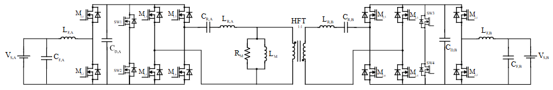
  <br>
  <em>Isolated single-stage bidirectional V2V converter: OBC bridge of EV1 (left), external resonant HFT connector (centre), OBC bridge of EV2 (right). Topology after Zhou et al. (2026)</em>
</p>

### Components

| Symbol | Component | Function |
|---|---|---|
| VS,A, VS,B | EV1 / EV2 batteries | Source or sink, depending on mode |
| LF, CF | Battery-side filter | Limit battery current and voltage ripple |
| Mx,1–Mx,2 + CD | Boost/buck leg + DC link | Voltage-gain stage |
| Mx,3–Mx,6 | High-frequency H-bridge | Excites the connector (Mx,5 held on, Mx,6 held off) |
| CR, LR | Series-resonant tank (LR = transformer leakage) | Shapes current, supports soft switching |
| HFT (LM, RM) | 1:1 high-frequency transformer | Galvanic isolation; magnetizing inductance and core loss modelled |

### Gate-Signal Assignment

The controller produces a PWM signal with duty ratio D and its complement (NPWM). The two modes use the same hardware and differ only in this mapping:

| Signal | Mode 1 (EV1 → EV2) | Mode 2 (EV2 → EV1) |
|---|---|---|
| PWM (D) | M1,2, M1,3, M2,1, M2,4 | M1,1, M1,4, M2,2, M2,3 |
| NPWM (1-D) | M1,1, M1,4, M2,2, M2,3 | M1,2, M1,3, M2,1, M2,4 |
| Constant 1 | M1,5, M2,5 | M1,5, M2,5 |
| Constant 0 | M1,6, M2,6 | M1,6, M2,6 |

### Mode 1: EV1 → EV2

**Stage 1 (PWM high):**

- Battery A stores energy in LF,A through M1,2.
- CR,A discharges through the resonant network.
- The HFT transfers energy to side B, where LF,B releases energy into battery B.

**Stage 2 (NPWM high):**

- The energy in LF,A is released, together with energy from the source, into the DC link.
- The source bridge recharges the tank.
- Energy again passes through the HFT, and LF,B charges while battery B keeps charging.

### Mode 2: EV2 → EV1

The PWM and NPWM assignments are swapped, so power flows from battery B to battery A.

---

## Design Calculations

### Specifications

| Parameter | Value |
|---|---:|
| EV1 battery | 350 V, 60 Ah |
| EV2 battery | 450 V, 80 Ah |
| Rated power | 24 kW |
| Switching frequency fS | 20 kHz |
| Filter inductance LF,A / LF,B | 3.14 mH / 4.8 mH |
| Filter capacitance CF,A / CF,B | 2 µF / 1.3 µF |
| DC-link capacitance CD,A / CD,B | 0.5 mF / 0.8 mF |
| Resonant capacitance CR (each side) | 0.21 mF |
| Resonant (leakage) inductance LR (each side) | 0.3015 µH |
| HFT turns ratio | 1:1 |
| Switch model (loss study) | Infineon IKWH75N65EH7 IGBT |

##  1. Battery-side filters

The filter inductor and capacitor are sized for a 5 % current ripple at \(D=0.57\):

$$
L_F = \frac{V_L\,D}{\Delta I_L\, f_S},
\qquad
C_F = \frac{\Delta I}{8\, f_S\, \Delta V}

$EV1 side (IL,rated = 63.5 A, VL = 350 V):


$$
L_{F,A} =
\frac{350 \times 0.57}
{0.05 \times 63.5 \times 20\times10^{3}}
= 3.14\ \text{mH}
$$

$$
\frac{\Delta V}{V} =
\frac{0.05 \times 63.5}
{8 \times 20\times10^{3} \times 2\times10^{-6} \times 350}
\approx 2.8\% \approx 3\%
\quad (C_{F,A}=2\ \mu\text{F})
$$

EV2 side (IL,rated = 52.9 A, VL = 450 V):


$$
L_{F,B} =
\frac{450 \times 0.57}
{0.05 \times 52.9 \times 20\times10^{3}}
= 4.8\ \text{mH}
$$

$$
\frac{\Delta V}{V} =
\frac{0.05 \times 52.9}
{8 \times 20\times10^{3} \times 1.3\times10^{-6} \times 450}
\approx 2.8\% \approx 3\%
\quad (C_{F,B}=1.3\ \mu\text{F})
$$

## 2. Resonant tank

$$
f_R =
\frac{1}{2\pi\sqrt{L_R C_R}}
=
\frac{1}{2\pi\sqrt{0.3015\times10^{-6} \times 0.21\times10^{-3}}}
\approx 20\ \text{kHz} = f_S
$$

The switching frequency is set equal to the resonant frequency. The open-loop gain study confirms that the gain is highest at \(f_S/f_R=1\).

## 3. Voltage gain (idealized)

Treat the series tank and the 1:1 HFT, operated at resonance, as the energy-transfer path of a Ćuk converter with average transfer voltage \(V_T\). Volt–second balance on the two filter inductors gives:

$$
D\,V_{S,A} + (1-D)(V_{S,A}-V_T) = 0
$$

$$
\Rightarrow V_T = \frac{V_{S,A}}{1-D}
$$

$$
D\,(V_T - V_{S,B}) - (1-D)\,V_{S,B} = 0
$$

$$
\Rightarrow V_{S,B} = D\,V_T
$$

$$
\boxed{
\frac{V_{S,B}}{V_{S,A}} = \frac{D}{1-D}
\quad (\text{Mode 1}),
\qquad
\frac{V_{S,A}}{V_{S,B}} = \frac{1-D}{D}
\quad (\text{Mode 2})
}
$$

These relations assume lossless components, unity tank gain and continuous inductor current. They locate the operating region; the actual duty ratios come from simulation (see Results).

## 4. Equivalent load for the open-loop tests

$$
R_L = \frac{V_{nom}^2}{P_{rated}}
$$

$$
R_{L,EV2} =
\frac{450^2}{24\,000}
= 8.4375\ \Omega
$$

$$
R_{L,EV1} =
\frac{350^2}{24\,000}
= 5.1042\ \Omega
$$

## Controller Design

All three controllers regulate the receiving battery's current and use the same structure:

**Mode selection → Error calculation → Control law → Duty-ratio limiter → Triangular carrier comparison → PWM / NPWM → Gate mapping**

The regulated current is IB2 in Mode 1 and IB1 in Mode 2. Only the control law changes between the three models.

### PI Controller

$$u(t) = K_p\,e(t) + K_i \int_0^t e(\tau)\,d\tau$$

| Parameter | Value |
|---|---:|
| Tuning method | Ziegler–Nichols |
| Kp | 0.0001 |
| Ki | 0.015 |

### Integral Sliding-Mode Controller (ISMC)

Sliding surface and boundary-layer control law:

$$s(t) = e(t) + \lambda \int_0^t e(\tau)\,d\tau, \qquad D_{cmd} = D_0 + k\,\text{sat}\!\left(\frac{s}{\phi}\right)$$

| Parameter | Value | Role |
|---|---:|---|
| λ | 2 | Weight of the integral error |
| φ | 0.5 | Boundary-layer width (scales s before saturation) |
| k | 0.005 | Correction gain |
| D0 | 0.5 | Nominal duty ratio |

The saturation function replaces the sign function to reduce chattering.

### Fuzzy Logic Controller (FLC)

Mamdani system, file `ev_v2v.fis`.

Inputs are the error e(k) and the change in error:

$$
\Delta e(k)=e(k)-e(k-1)
\
$$

Both inputs are normalized to [-1, 1]. The output is the duty command on [0, 1].

**Input membership functions:**

| Variable | Membership Function | Parameters [a b c] |
|---|---|---|
| error, del_error | NB | [-1 -1 -0.5] |
| error, del_error | NS | [-1 -0.5 0] |
| error, del_error | Z | [-0.25 0 0.25] |
| error, del_error | PS | [0 0.5 1] |
| error, del_error | PB | [0.5 1 1] |

**Output membership functions:**

| Variable | Membership Function | Parameters [a b c] |
|---|---|---|
| control | Low | [0.30 0.40 0.50] |
| control | Medium | [0.45 0.50 0.55] |
| control | High | [0.50 0.60 0.70] |

**Rule base (L = Low, M = Medium, H = High).**

Rows are error, columns are del_error:

| e \ Δe | NB | NS | Z | PS | PB |
|---|---|---|---|---|---|
| NB | H | H | H | M | M |
| NS | H | H | M | M | L |
| Z | H | M | M | M | L |
| PS | M | M | M | L | L |
| PB | M | L | L | L | L |

Inference uses AND = min, OR = max, implication = min and aggregation = max, with centroid defuzzification:

$$u^* = \frac{\int_0^1 u\,\mu_{agg}(u)\,du}{\int_0^1 \mu_{agg}(u)\,du}$$

---

## Results

### 1. Open-Loop: Voltage Gain and Operating Points

<p align="center">
  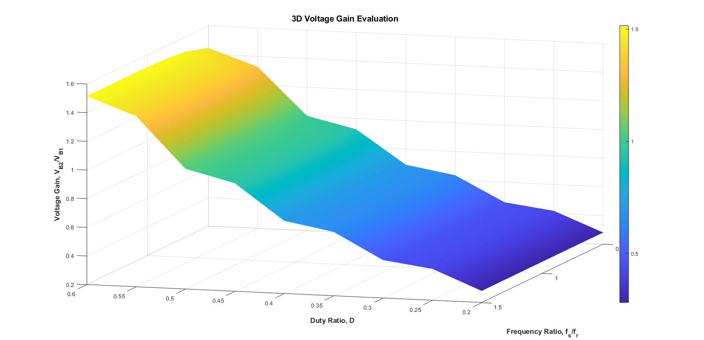
  <br>
  <em>Voltage gain versus duty ratio and frequency ratio fS/fR</em>
</p>

The gain is highest at fS/fR = 1 and falls as the switching frequency moves away from resonance. At a given frequency ratio, a larger D raises the gain.

<p align="center">
  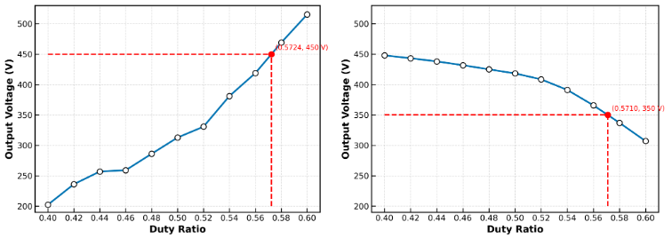
  <br>
  <em>Receiving-battery voltage versus duty ratio: Mode 1 (left) and Mode 2 (right)</em>
</p>

| Mode | Target Voltage | Simulated D | Ideal Voltage from Gain Equation | Deviation |
|---|---:|---:|---:|---:|
| Mode 1 | 450 V | 0.5724 | 468.5 V | -3.9% |
| Mode 2 | 350 V | 0.5710 | 338.1 V | +3.5% |

The simulated operating points are within 4% of the idealized gain. The difference comes from the switch, tank and transformer effects that the ideal equation neglects.

### 2. Open-Loop Waveforms

#### Mode 1 (EV1 → EV2), Rated Operating Point

<p align="center">
  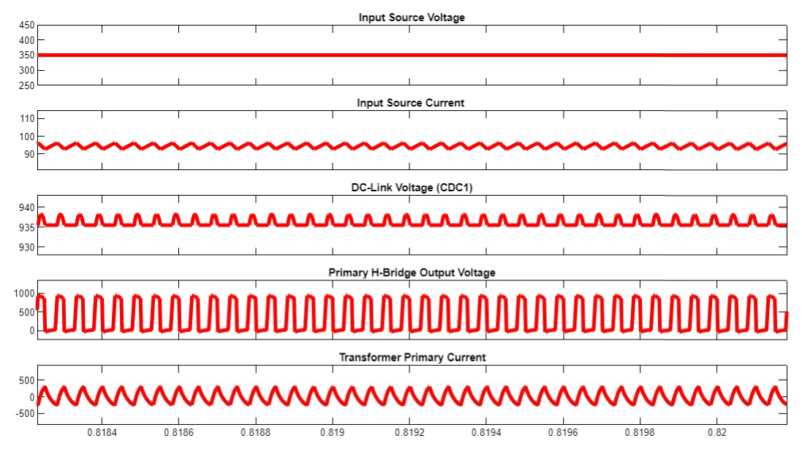
  <br>
  <em>Mode 1 – source side: battery voltage and current, DC-link voltage, primary bridge voltage, primary current</em>
</p>

<p align="center">
  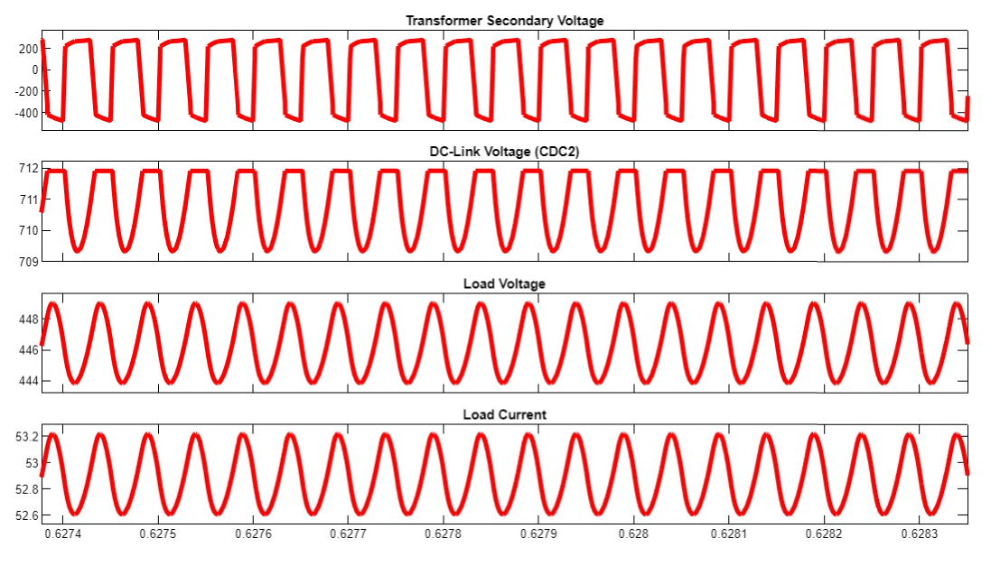
  <br>
  <em>Mode 1 – receiving side: secondary voltage, DC-link voltage, load voltage and current</em>
</p>

<p align="center">
  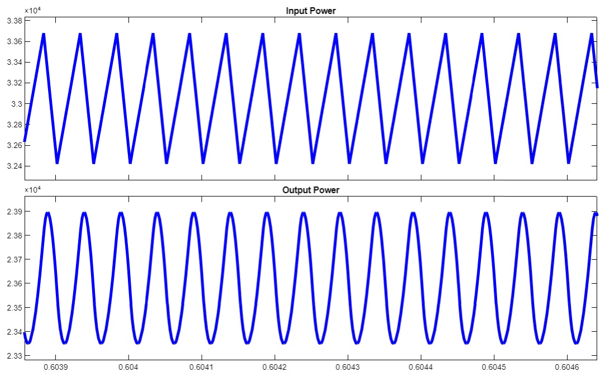
  <br>
  <em>Mode 1 – input and output power</em>
</p>

| Quantity (Mode 1) | Value (read from waveforms) |
|---|---:|
| Source current | ≈ 94 A (ripple ≈ ±3 A) |
| DC-link voltage (CDC1) | ≈ 936 V |
| Primary bridge voltage | 0–950 V unipolar pulses |
| Transformer primary current | ≈ -250 A to +300 A |
| Load voltage / current | ≈ 446 V (±2 V) / ≈ 52.9 A |
| Input / output power | ≈ 33.1 kW / ≈ 23.6 kW |
| Efficiency | ≈ 71% |

#### Mode 2 (EV2 → EV1)

<p align="center">
  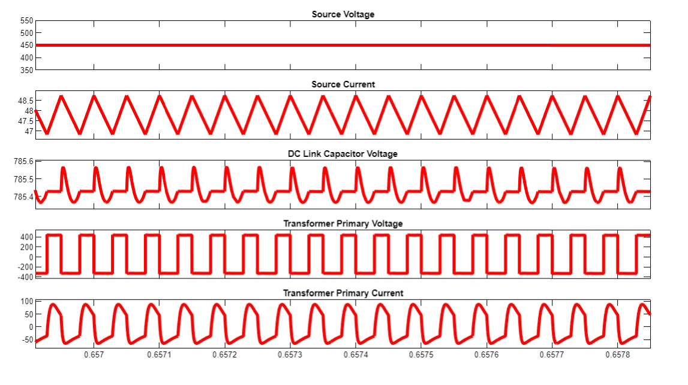
  <br>
  <em>Mode 2 – source side: battery voltage and current, DC-link voltage, primary voltage and current</em>
</p>

<p align="center">
  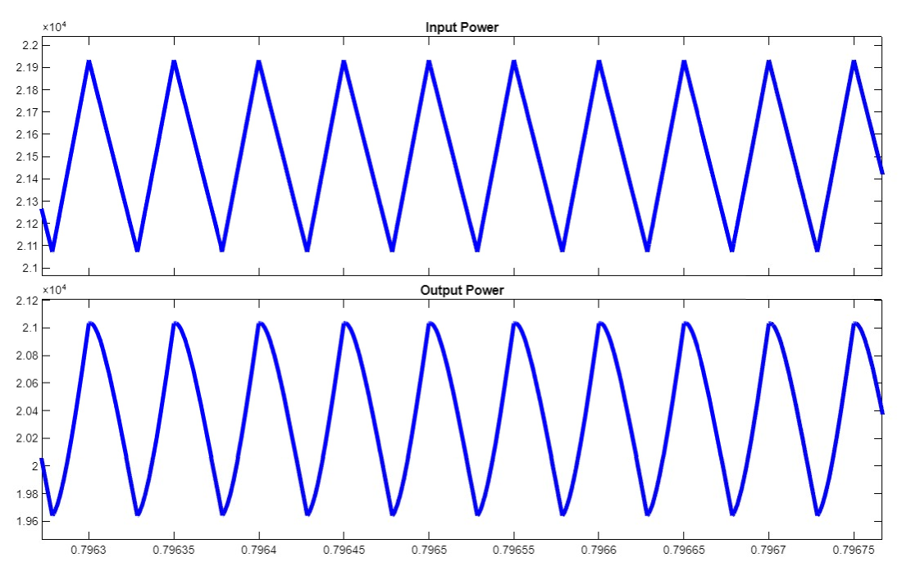
  <br>
  <em>Mode 2 – input and output power</em>
</p>

| Quantity (Mode 2) | Value (read from waveforms) |
|---|---:|
| Source voltage / current | 450 V / ≈ 47.8 A |
| DC-link voltage | ≈ 786 V |
| Load voltage / current | ≈ 322 V / ≈ 63.3 A |
| Input / output power | ≈ 21.5 kW / ≈ 20.4 kW |
| Efficiency | ≈ 95% |

### 3. Closed-Loop Steady-State Current Tracking

Reference: 10 → 50 A in 10 A steps every 3 s.

Each value is the mean regulated current between 0.6 s and 2.8 s after a step.

<p align="center">
  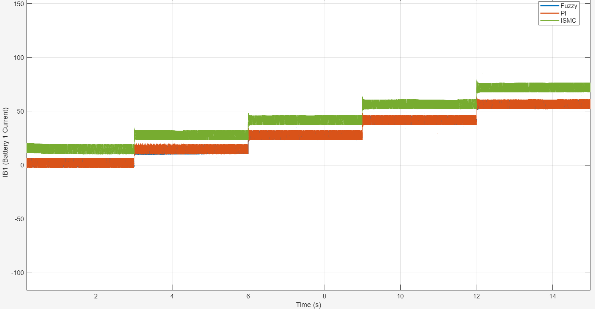
  <br>
  <em>Mode 1 – EV1 battery current with PI, ISMC and FLC</em>
</p>

<p align="center">
  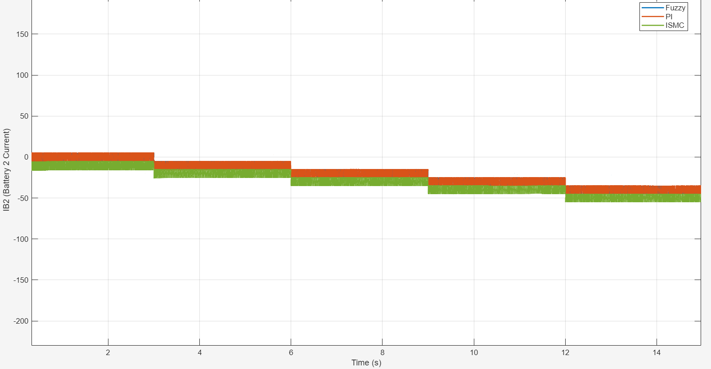
  <br>
  <em>Mode 1 – EV2 battery current with PI, ISMC and FLC (negative = charging)</em>
</p>

**Mode 1 – EV1 → EV2**

| Reference (A) | PI | ISMC | FLC |
|---:|---:|---:|---:|
| 10 | ≈ 0 | 10.2 | ≈ 0 |
| 20 | 9.4 | 19.8 | 10 |
| 30 | 19.2 | 29.7 | 19 |
| 40 | 29.1 | 39.5 | 29 |
| 50 | 39.3 | 49.7 | 39 |
| Resolution | ±0.6 | ±0.6 | ±1.5 |

**Mode 2 – EV2 → EV1**

| Reference (A) | PI | ISMC | FLC |
|---:|---:|---:|---:|
| 10 | 10 | 9.9 | ≈ 0 |
| 20 | 21 | 20* | 12 |
| 30 | 31 | 29.8 | 21 |
| 40 | 40 | 39.8 | 31 |
| 50 | 51 | 49.7 | 42 |
| Resolution | ±3 | ±0.5 | ±2 |

\* Converges slowly within this step, from about 17 A to 22 A.

Peak-to-peak ripple of the regulated current is about 9–11 A for all three controllers.

In the overlay plots the FLC trace (blue) is hidden under the PI trace, because in Mode 1 they settle at the same levels.

### 4. Start-Up Transient (Mode 1, First 0.1 s)

<p align="center">
  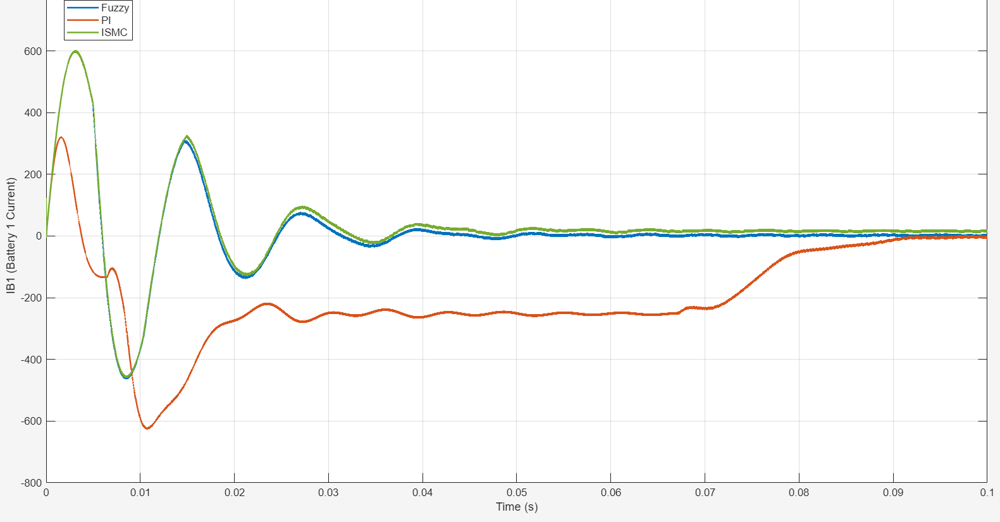
  <br>
  <em>Start-up transient – EV1 current</em>
</p>

<p align="center">
  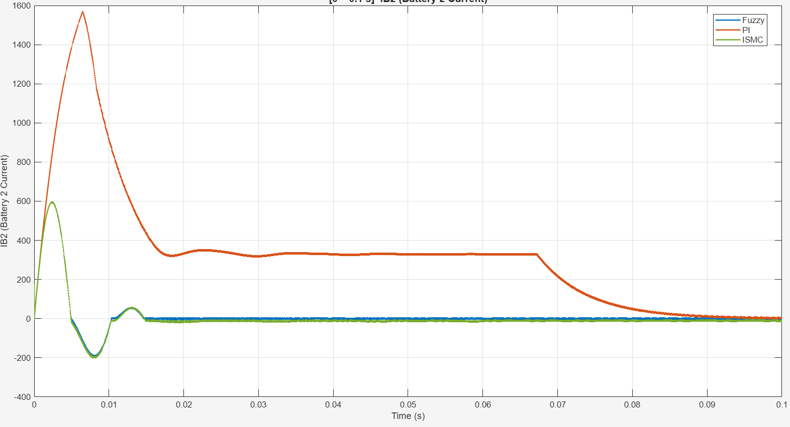
  <br>
  <em>Start-up transient – EV2 current</em>
</p>

<p align="center">
  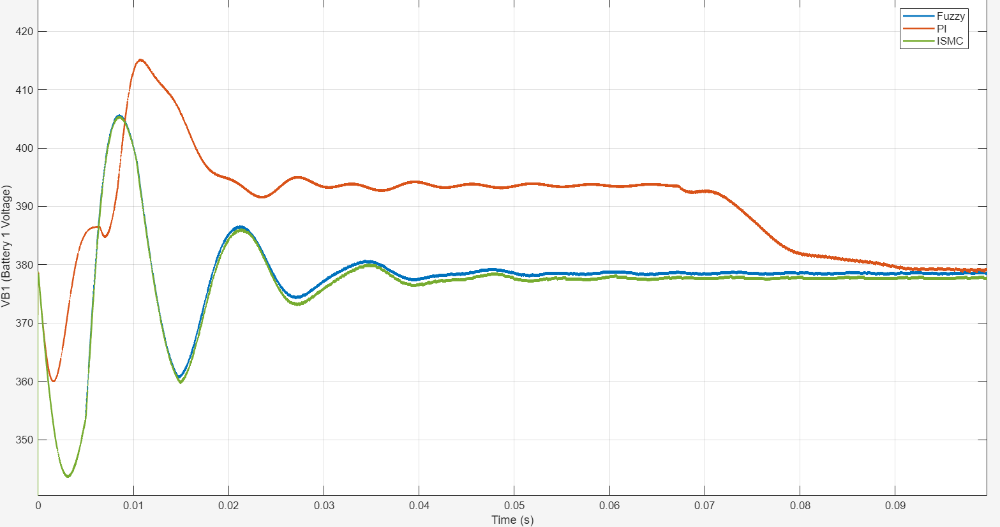
  <br>
  <em>Start-up transient – EV1 voltage</em>
</p>

<p align="center">
  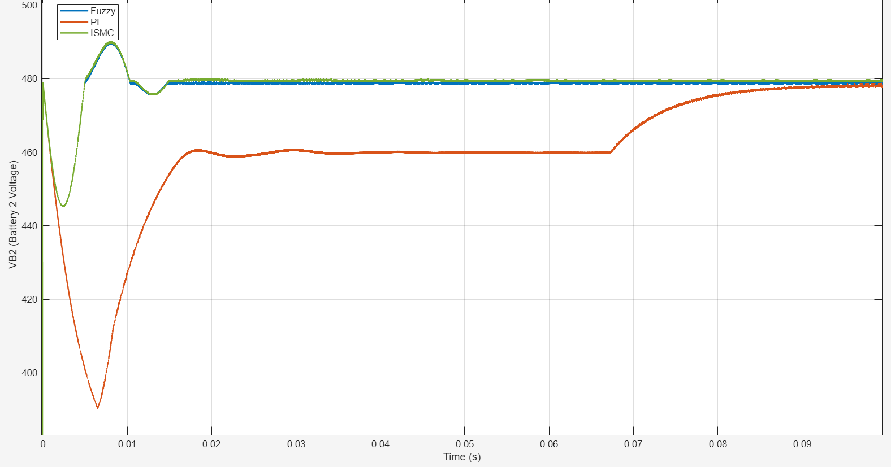
  <br>
  <em>Start-up transient – EV2 voltage</em>
</p>

| Controller | Peak \|IB1\| (A) | Peak \|IB2\| (A) | Max ΔVB2 (V) | ts VB1 (ms) | ts VB2 (ms) | ts IB2 (ms) |
|---|---:|---:|---:|---:|---:|---:|
| PI | 625 | 1567 | 86.2 | 74.3 | 70.6 | 84.5 |
| ISMC | 600 | 594 | 34.1 | 22.1 | 8.6 | 14.5 |
| FLC | ≈ 600 | ≈ 594 | ≈ 34 | 21.8 | 8.6 | 14.2 |

ts is the settling time to ±2% of the final value for voltages and to ±20 A for currents.

FLC coincides with ISMC during the first 5 ms.

Extraction resolution is about ±2.5 A, ±0.15 V and ±0.07 ms.

### 5. Efficiency

<p align="center">
  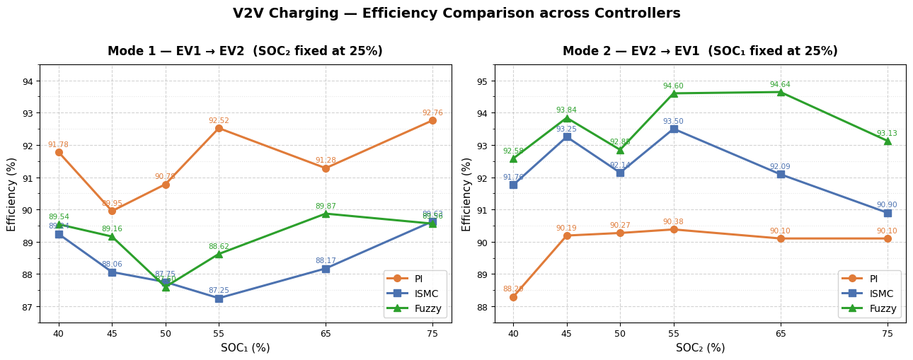
  <br>
  <em>Efficiency versus source-battery SOC for PI, ISMC and FLC: Mode 1 (left) and Mode 2 (right)</em>
</p>

The receiving battery is held at 25% SOC while the source-battery SOC is swept.

\[
\eta=\frac{P_{out}}{P_{in}}\times100\%
\]

**Mode 1 – EV1 → EV2**

| Source SOC (%) | 40 | 45 | 50 | 55 | 65 | 75 | Mean |
|---|---:|---:|---:|---:|---:|---:|---:|
| PI | 91.78 | 89.95 | 90.78 | 92.52 | 91.28 | 92.76 | 91.51 |
| ISMC | 89.24 | 88.06 | 87.75 | 87.25 | 88.17 | 89.62 | 88.35 |
| FLC | 89.54 | 89.16 | 87.60 | 88.62 | 89.87 | 89.58 | 89.06 |

**Mode 2 – EV2 → EV1**

| Source SOC (%) | 40 | 45 | 50 | 55 | 65 | 75 | Mean |
|---|---:|---:|---:|---:|---:|---:|---:|
| PI | 88.29 | 90.19 | 90.27 | 90.38 | 90.10 | 90.10 | 89.89 |
| ISMC | 91.76 | 93.25 | 92.14 | 93.50 | 92.09 | 90.90 | 92.27 |
| FLC | 92.58 | 93.84 | 92.85 | 94.60 | 94.64 | 93.13 | 93.61 |

### 6. Semiconductor Losses (ISMC, Mode 2)

Conduction loss uses the datasheet VCE,sat(IC) curve, and switching loss uses the datasheet Eon/Eoff energies at each detected gate transition.

The average over the logged interval is computed with `avg_loss.m`:

\[
P_{cond}=V_{CE,sat}(I_C)I_C
\]

\[
P_{sw}=
\frac{\sum E_{on}+\sum E_{off}}
{t_{end}-t_{start}}
\]

<p align="center">
  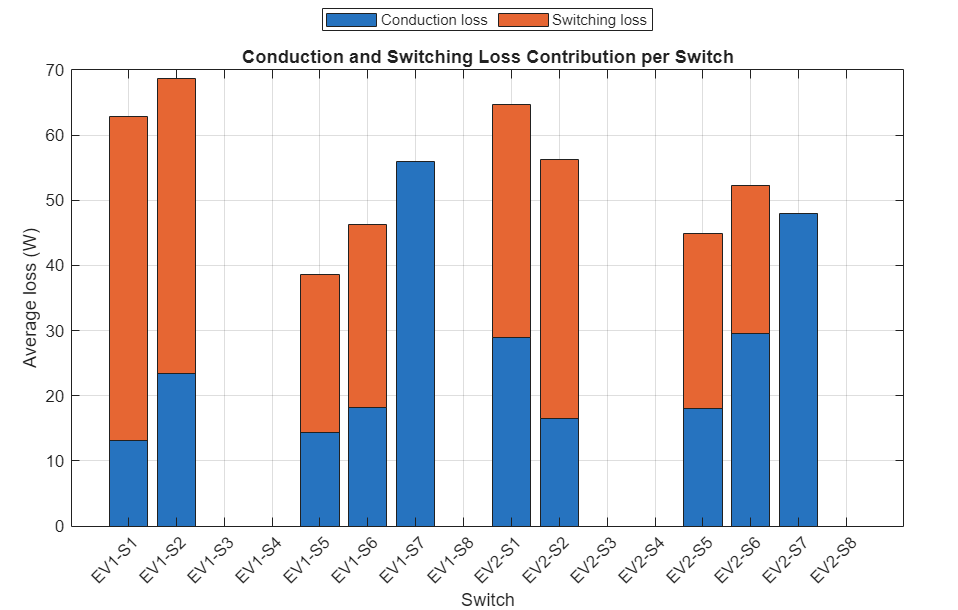
  <br>
  <em>Conduction and switching loss of each switch (ISMC, Mode 2)</em>
</p>

| Side | Conduction (W) | Switching (W) | Total (W) |
|---|---:|---:|---:|
| EV1 | 124.96 | 147.23 | 272.19 |
| EV2 | 140.95 | 125.19 | 266.13 |
| **Total** | **265.91** | **272.42** | **538.32** |

Switching loss dominates in the switched legs (EV1-S1, EV1-S2).

The always-on switches (EV1-S7, EV2-S7) have conduction loss only.

Inactive switches show zero loss.

### 7. OPAL-RT Software-in-the-Loop

<p align="center">
  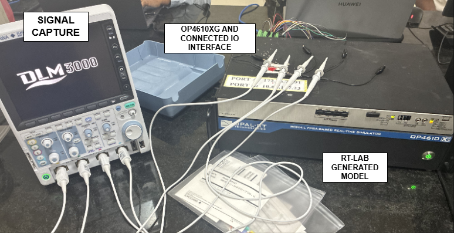
  <br>
  <em>OPAL-RT OP4610XG with analog interface and oscilloscope</em>
</p>

<p align="center">
  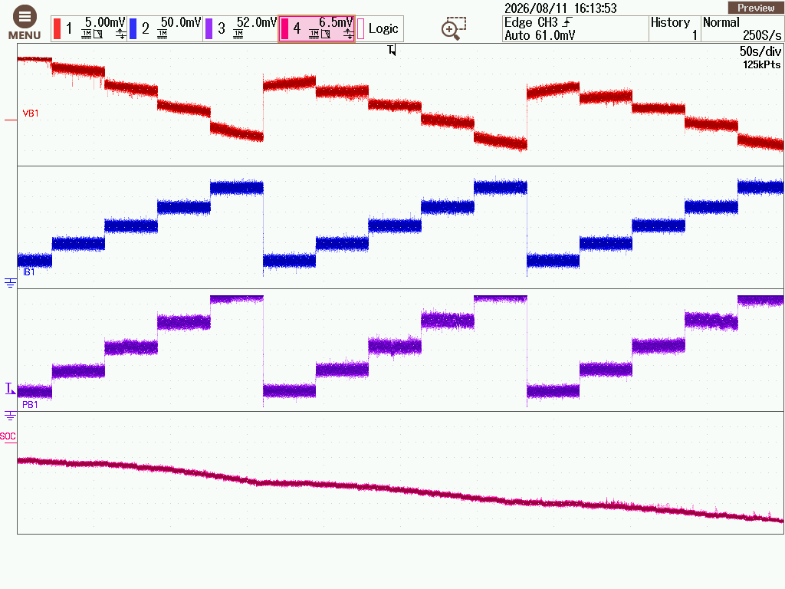
  <br>
  <em>OPAL-RT SIL capture – PI, Mode 1 (EV1 voltage, current, power, SOC)</em>
</p>

<p align="center">
  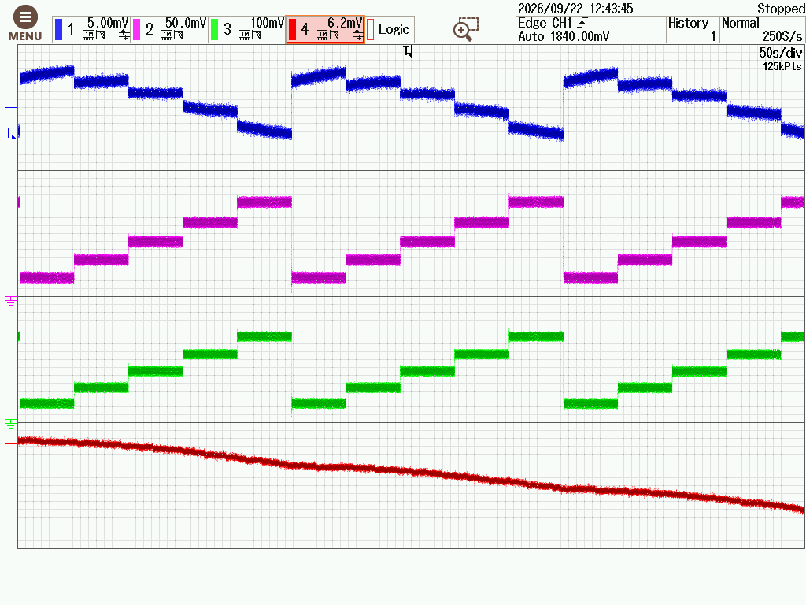
  <br>
  <em>OPAL-RT SIL capture – ISMC, Mode 1</em>
</p>

<p align="center">
  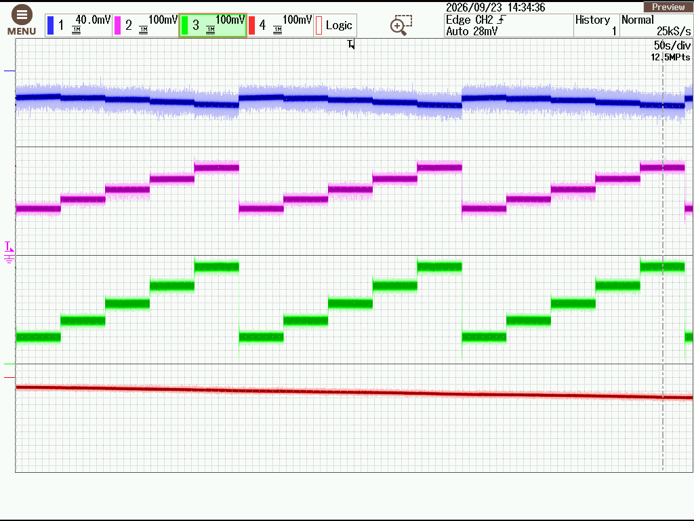
  <br>
  <em>OPAL-RT SIL capture – FLC, Mode 1</em>
</p>

The model runs in real time on the OP4610XG with a 5 µs step. Oscilloscope captures of battery voltage, current, power and SOC show the stepwise response and a monotonic SOC change for all three controllers in both modes, matching the offline results.

These are SIL results: the converter is simulated, not hardware.

---

## Analysis and Discussion

### Overall Controller Comparison

| Criterion | PI | ISMC | FLC |
|---|---|---|---|
| Steady-state tracking, Mode 1 | Offset ≈ 10 A | Within ≈ 0.5 A | Offset ≈ 10 A |
| Steady-state tracking, Mode 2 | Within ≈ 1 A | Within ≈ 0.5 A (slow in one step) | Offset 8–11 A |
| Start-up peak \|IB2\| (Mode 1) | 1567 A | 594 A | ≈ 594 A |
| Settling time of VB2 (Mode 1) | 70.6 ms | 8.6 ms | 8.6 ms |
| Mean efficiency, Mode 1 / Mode 2 | 91.51% / 89.89% | 88.35% / 92.27% | 89.06% / 93.61% |
| Real-time SIL | Both modes | Both modes | Both modes |

### 1. Direction-Dependent Performance

ISMC is the only controller that tracks the reference in both directions.

With the present tuning:

- PI tracks only in Mode 2.
- FLC tracks in neither mode.

The gate mapping changes with the mode, so a controller tuned for one direction cannot be assumed to work in the other.

### 2. Start-Up Behaviour

ISMC and FLC improve start-up behaviour.

They cut the start-up current peak by about 62% and the voltage dip by about 60%, and settle 3–8× faster than PI.

The two behave almost identically in this interval.

### 3. Efficiency Comparison

The efficiency ranking is confounded.

In each direction, the most efficient controller (PI in Mode 1, FLC in Mode 2) is also one that delivers about 10 A less current than the reference.

Losses grow with current, so part of the difference reflects the operating point rather than the control law.

The cleaner comparison is Mode 2, where both ISMC and PI track the reference: ISMC is about 2.4 points more efficient there.

Efficiency should be re-measured at equal delivered power.

### 4. Open-Loop Directional Performance

The modes behave very differently in open loop.

Mode 1 has a large circulating primary current (±250–300 A) and only about 71% efficiency at rated power.

Mode 2 shows about 95% at its recorded operating point.

The resonant link needs optimizing for Mode 1.

### Why the Offsets Appear (Likely Causes)

**PI:**

The Ziegler–Nichols gains (Kp = 0.0001, Ki = 0.015) were tuned once and reused in both directions. The integral action is too weak to remove the Mode 1 error within a 3 s step.

**FLC:**

There is no explicit integral state, and the narrow output membership functions (0.3–0.7) limit the duty correction to about ±0.1 around 0.5.

**Overall:**

Of the three controllers as tuned here, ISMC is the most suitable for this topology.

---

## Limitations

- **Simulation and SIL only:** No hardware-in-the-loop (HIL) testing or prototype yet.
- **Tuning:** PI and FLC were not retuned per direction, and their steady-state offsets make the efficiency comparison partly unfair.
- **Initial conditions:** Some runs start from different SOCs, so absolute SOC traces are not directly comparable.
- **Metric extraction:** The transient and steady-state metrics were read from recorded waveform plots (resolutions are listed). Re-extracting them from logged data, for example with `stepinfo`, would tighten them.
- **Device ratings:** The simulated DC link reaches about 936 V (Mode 1) and about 786 V (Mode 2), and the primary current reaches about 300 A. The IGBT used for the loss model is rated 650 V / 75 A. A real design needs 1200 V-class devices (for example SiC MOSFETs), so the loss figures are indicative only.
- **Not modelled:** Soft-start, protection, thermal behaviour, EMI and inter-vehicle communication.

---

## Future Work

- Retune PI per direction and add integral action to the FLC; repeat the efficiency comparison at equal delivered power.
- HIL validation on the OPAL-RT platform.
- Compare Si and SiC devices for losses and efficiency.
- Optimize the resonant tank to reduce circulating current in Mode 1.
- PCB design and a hardware prototype with OBC-compatible interfaces and a vehicle-to-vehicle communication link.

---

## Authors

**N. Subramanian**  
**Sahas Vishanth M. V.**  
**Tanukasree R.**

**Supervisor:** Dr. G. Kanimozhi

School of Electrical Engineering (SELECT),  
Vellore Institute of Technology, Chennai, India.

The authors thank the School of Electrical Engineering, VIT Chennai, for access to the OPAL-RT real-time simulation laboratory.

---

## Citation and License

### Reference Topology

The converter topology modelled here is from:

R. Zhou, B. Chong, B. Labaleine, J. Arnett, and L. Zhang, "A novel isolated connector for bidirectional direct V2V charging using onboard chargers," *e-Prime – Nexus of Electrical, Electronic, and Intelligent Engineering*, vol. 17, Art. no. 201193, 2026.

[https://doi.org/10.1016/j.eprime.2026.201193](https://doi.org/10.1016/j.eprime.2026.201193)

### Semiconductor Reference

Infineon IKWH75N65EH7 (650 V TRENCHSTOP IGBT7) datasheet.

### Citing This Repository

If you use this repository, please cite it as:

N. Subramanian, Sahas Vishanth M. V., Tanukasree R., and G. Kanimozhi,

"Isolated Single-Stage Bidirectional V2V EV Charging Converter: PI, ISMC and Fuzzy Current Control,"

GitHub repository, 2026.

### License

Add a `LICENSE` file (for example, MIT) before making the repository public.

---

**Keywords:** Bidirectional V2V Charging, Electric Vehicles, Isolated DC-DC Converter, Single-Stage Converter, Ćuk Converter, Resonant Converter, PI Control, Integral Sliding-Mode Control, Fuzzy Logic Control, MATLAB/Simulink, OPAL-RT, Software-in-the-Loop Validation.
